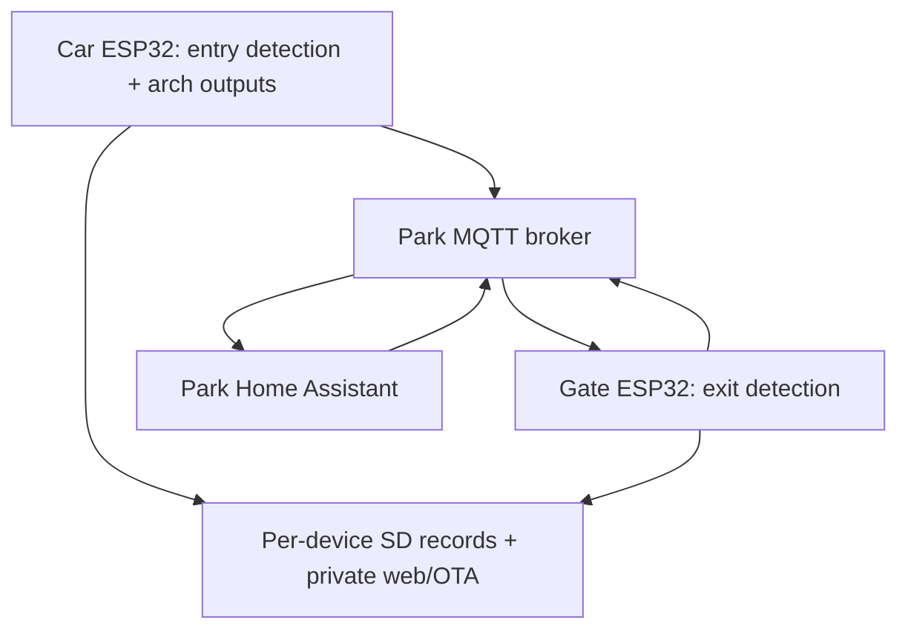

# MSB Traffic Counter — combined engineering assessment

Status: REVIEW DRAFT. Documentation and static source assessment only. No firmware, HA configuration, MQTT state, device files, or production settings changed.

## Decision

Refactor the Car and Gate counters toward the same small set of services and diagnostic conventions. Preserve their existing detector algorithms as separate policies first. Similar state names do not establish equivalent counting rules. Do not replace the Car detector with the Gate detector or reintroduce the Gate's removed A-to-B timeout reset.

Keep the two application repositories initially. Make the Gate repository the home of this combined assessment; the Car repository should link to it. Use matching module boundaries in both applications, then extract proven identical services into a pinned, versioned common library. Do not maintain copied common code indefinitely. A repository merger or new shared-library repository is a later design decision, not a prerequisite for the first extraction.

The main inefficiency is unpredictable time between input samples, not demonstrated ESP32 CPU exhaustion. Network waits, whole-file SD rewrites, direct MQTT calls inside detection, and display refresh on every pass interfere with the polling path. Moving code into headers alone will not solve that.

## Evidence and limits

| Baseline | Repository / ref | Evidence |
|---|---|---|
| Car release 25.12.03.2 | `Gregovate/MSB-Car-Counter-2024`, `5a01aec573f2b08c6cc3f36995af3aedd42e56c9` | `src/main.cpp` version, release commit, `firmware/firmware25.12.03.2.bin`; operator screenshot shows same version |
| Car current main | `928d6c61c4cfa0275239c8e168c13f84fb73c525` | Source also declares 25.12.03.2. Later source commit `17600155505c255825ea058d5c5a4925e105be98` only removes TempF/Humidity from the EnterLog header. A displayed version cannot distinguish these sources |
| Gate show release 25.12.28.0 | `Gregovate/MSB-Gate-Counter-2025`, `feature/dual-beam-gate`, `4b18fe284591f5f2aa58e3af1269ece75eaae003` | `src/main.cpp`, commit and `firmware/firmware25.12.28.bin`; screenshot shows same version |
| Older Gate magnetic implementation | Same Gate 2025 repository, main `0ebacc9fa7dd29299fe0eec9b6b78a939955b670` | Older `detectCar()` uses magnetic input plus beam. Gate 2024 main has the same main.cpp blob `6b12f779450f4a7d94684bfa669d84e31341a0c5` |
| HA analytics evidence | `traffic_analytics.yaml`, Library `libfile_92c60620bc588191b0d1be028ebdab32`, version 1; 615 lines | Full file read. This is available configuration evidence, not proof of deployed HA state |
| Operator requirements | Current workstream | Car operates during the show season only. One Gate ESP32 serves on-season dual beam and off-season magnetic sensing using different inputs. ElegantOTA and a web server on each device must remain. ESP32 administration must stay private |

The Car release has approximately 3,839 source lines; the Gate show release 3,071; the magnetic reference 1,922. Comments contain useful design history and reliability decisions. They also contain stale claims; executable control flow takes precedence for observed behavior.

This assessment traces startup, detection, counts, persistence, networking, callbacks, scheduling, summaries, UI and OTA. It is static analysis, not a build, binary provenance verification, timing measurement, hardware acceptance, security audit, or live HA validation. Private credentials and vendored ElegantOTAPro dependencies were not retrieved. No field count accuracy percentage or latency improvement is claimed.

Source references below use immutable commits through [Source index](Source_Index.md). `C`, `G`, and `M` mean Car release, Gate show release, and magnetic reference respectively. Line numbers refer to their `src/main.cpp` files.

## System boundary and ownership

Both ESP32s use Arduino on ESP32 under PlatformIO, RTC DS3231, SSD1306 OLED, DHT22, SD storage, PubSubClient, WiFiMulti, ESPAsyncWebServer and ElegantOTAPro. This is custom Arduino firmware; calling its web server an ESPHome server does not establish use of ESPHome.

The Car owns locally detected entry events. The Gate owns locally detected exit events. The Gate currently derives in-park occupancy from received Car EnterTotal minus its own totalDailyCars. HA uses that derived occupancy as its canonical occupancy. Retained MQTT is a distribution snapshot, not automatically an authoritative recovery journal.

HA commands can assign counts and tune selected settings. Effective setting ownership is inconsistent at startup: devices also publish defaults to command/configuration topics. This must be resolved explicitly without renaming deployed topics during structural extraction.

## Device behavior to preserve

### Car seasonal detector

Inputs: first beam GPIO 33, second beam GPIO 32; raw HIGH is treated as broken. Both inputs use INPUT_PULLDOWN. Arch outputs are GPIO 25 and 26. Debounce 50 ms; minimum activation 100 ms; waitDuration 950 ms; alarm default 60,000 ms. Defaults are not proof of effective values after HA commands.

| State | Actual transition |
|---|---|
| WAITING_FOR_CAR | Beam A high starts FIRST_BEAM_HIGH even if B is already high |
| FIRST_BEAM_HIGH | If B is high and elapsed time since A started meets both activation and waitDuration, latch carPresentFlag and enter BOTH_BEAMS_HIGH. Otherwise A clear while B is low resets to idle |
| BOTH_BEAMS_HIGH | B clear with carPresentFlag moves to CAR_DETECTED. No final broken-duration rejection |
| CAR_DETECTED | Next polling pass computes TTP, counts once, sets arch outputs and returns to idle |

Evidence: C:2889–3077. The wait threshold is measured from A's initial detection; despite some comments, it is not a measurement of B remaining continuously broken for 950 ms. In FIRST_BEAM_HIGH the B-high branch is considered before A-clear. Preserve this ordering in characterization tests before discussing changes.

Arch idle pattern is a separate nonblocking state machine, invoked after 30 seconds without a counted car while showTime is true. noCarTimer is reset when a car is counted, not at initial beam activation. During a sufficiently slow passage the idle-pattern writes can overlap detector output writes (C:2698–2765, 2809, 3824). Put arch ownership behind one output service; treat any arbitration change as a behavior change.

### Gate show detector

Inputs: Beam A uses GPIO 32 under the legacy name magSensorPin; Beam B uses GPIO 33. Both use INPUT. The active detector maps raw HIGH to broken. Some surrounding comments say the opposite. Debounce 50 ms; minActivationDuration 150 ms; carDetectMS default 1,000 ms; maxABFollow_ms 900 ms is diagnostic-only; alarm default 60,000 ms.

| State | Actual transition |
|---|---|
| WAITING_FOR_CAR | Start only when A is broken and B is clear |
| BEAM_A_HIGH | B broken plus elapsed time since A >=150 ms enters BOTH_BEAMS_HIGH. A clear while B is not broken returns to idle |
| BEAM_A_HIGH, delayed B | Above 900 ms, log once and continue waiting; never reset solely because that interval expired |
| BOTH_BEAMS_HIGH | When B clears, elapsed time since entry into this state must meet carDetectMS; otherwise reject and return to idle |
| CAR_DETECTED | Compute TTP, count once, then return to idle |

Evidence: G:425–465, 2335–2542, 2957–2983. The state called BOTH_BEAMS_HIGH is not continuously revalidated against A; it is a latched progression state. Do not relabel its timer as a physically measured continuous overlap. AB follow is repeatedly computed while B is high but the 150 ms threshold has not yet been reached, unlike the Car's one-shot capture.

The December 28 change is an explicit heavy-traffic reliability requirement. Test delayed B at 901 ms, multiple seconds, and long queues; diagnostic timeout must not discard the car.

### Gate off-season reference

M:1351–1471 reads inverted magnetic GPIO 32 and beam GPIO 33. It times a beam interval and counts at beam clear when duration >=carDetectMS OR the magnetic trigger flag is set. The magnetic pretrigger expires after 750 ms if a beam interval has not begun. A magnetic trigger during an active beam interval can qualify a short beam interval. The beam-start path clears the earlier magnetic latch.

Thus the available historical implementation is not a standalone magnetic-only counter: beam completion still drives counting. This does not override the operator's description of off-season operation. It identifies a reconciliation requirement: record actual input wiring/switching and identify the source used for any magnetic-only operation before defining a combined firmware mode.

The show branch contains no runtime seasonal detector selector. It repurposes the magnetic input name for Beam A. One Gate ESP32 with seasonal input arrangements is established; simultaneous connections, a hardware selector, automatic date switching, and an existing software selector are not established. Treat a single firmware with explicit modes as a proposed feature rather than a completed refactoring requirement. Choose switching behavior only after input evidence is recorded. Never switch algorithms in the middle of an active detection event.

## Findings and priorities

Priorities identify implementation order and consequence, not measured field failure frequency. CONFIRMED means the source path exists; its impact under real traffic must be tested.

| ID | Priority | Finding / evidence | Consequence and proposed treatment |
|---|---|---|---|
| F01 | High | Both runtime Wi-Fi recovery paths can call setup_wifi(), whose fallback loops until connected. C:809–879,1758–1781; G:676–713,1508–1531 | Detection can stop during an outage and boot cannot reach counting without Wi-Fi. Replace with bounded retry states after baseline tests; initialize local counting independently of network readiness |
| F02 | High | Detection runs late in both loops; OLED display.display() runs every pass; Car also synchronously scans for preferred AP when on backup. C:884–899,3561–3593,3772–3838; G:2826–2863,3046–3070 | Input polling gap has no bound. Schedule OLED at a fixed rate, measure all service durations, remove blocking reconnection/scanning from acquisition path |
| F03 | High | Gate saveHourlyCounts() reads and rewrites all historic hourly CSV rows for every car; Car does the same on its deferred checkpoint. G:1763–1836,2231–2315; C:2197–2313,1505–1587 | Work and transient String memory grow with the season. Separate compact current-day checkpoint from append-only exports; stage any file-format migration explicitly |
| F04 | High | Gate queue flusher has no caller. Car flushes only once after reconnect, max150. Both connected publish and queue flush ignore publish() return; queue pops before success; cap3000 drops oldest. C:1419–1473,1741; G:1206–1290 and complete call-site search | Offline data can remain indefinitely or be discarded; diagnostic traffic competes with counts. Use distinct coalesced state and bounded event lanes, progressive budgeted drain, success/failure metrics. Publish success means local client acceptance, not durable end-to-end delivery |
| F05 | High | MQTT reconnect publishes counts before SD restore. Car totalsInitialized guard exists only in heartbeat, not reconnect; it never subscribes to own count state for restoration. C:1547,1650–1755,2453–2545,3596–3770; G:1382–1483,1918–1979,2866–3044 | Boot can publish zeros before valid state; no-SD claims about leaving HA unchanged are not enforced globally. Introduce explicit initializing/valid/degraded state and recovery precedence; publish counts only once validity is established |
| F06 | High | Car new-day reboot branch omits getShowTotal(); only same-day branch restores season total. Both use day-of-month alone for day comparison. C:2453–2545; G:1918–1979 | Car can lose prior season total after a new-day reboot. Same numbered day in a different month can be mistaken for same date. Restore independent fields before rollover, use full-date keys |
| F07 | High | Date actions rely on exact minute/second flags; flags are RAM only; summary methods return void and callers mark saved regardless of failure. C:3452–3556; G:2747–2822 | Missed actions, duplicate summaries after reboot in save minute, and false success after failed SD write. Use persistent date/action completion keys and result-returning, idempotent summary operations |
| F08 | High | Gate show-date callback checks only string length, does not populate numeric year/month/day or call saveShowStartDate(). saveShowStartDate() has no caller; getShowStartDate() reads into an unterminated char buffer before sscanf. G:1210–1237,1489–1506,2021–2031 | Date-valid state can be true with numeric zeros; day computation is inconsistent and malformed persisted input is unsafe to parse. One validated typed configuration object with explicit persistence/result |
| F09 | Medium | Gate builds hour topics with "%s/%02d" while base already ends in slash; Car uses "%s%02d". G:385,1672,1823,2264; C:407,2839 | Actual Gate topics contain `Cars/hour//HH`. Preserve exact wire topics first; correct with coordinated HA compatibility migration, not cosmetic cleanup |
| F10 | Medium | Event CSV is written before timeBetweenCars_ms is updated for the current event in both detectors. C:2809–2886,3040–3068; G:2231–2315,2516–2536 | CSV interval belongs to preceding event while MQTT interval is newer. Assemble immutable complete event before persistence/publish; first event interval should be explicitly invalid rather than uptime |
| F11 | Medium | Count operations mix storage and publishing. Car immediate EnterTotal/System/time publishes occur only after event-log open succeeds; heartbeat eventually republishes when initialized. Gate saveDailyTotal publishes even on file failure but before occupancy is recalculated; later fresh publish in countTheCar requires event-log open. C:2809–2886,1547; G:1697–1710,2231–2315 | SD faults change freshness, not simply local logging. Gate may briefly publish new exits with previous occupancy. Count once in RAM; build one coherent snapshot; independently persist and publish |
| F12 | Medium | Car dirty hourly checkpoint uses only hour at flush time, updates only that column, and clears dirty flags without a save result. C:1571–1584,2197–2313 | A car near an hour boundary may never checkpoint the preceding hour's final increment. Failures may be forgotten. Capture dirty buckets or checkpoint entire current-day array and clear only on success |
| F13 | Medium | Gate calendar is both mirrored from Car and locally scheduled/persisted; subscribed Car ShowTotal has no callback handler. Gate resetDailyCount does not recalculate occupancy before publishing. G:1439–1452,2015–2153,2747–2822 | Competing calendar writers and stale occupancy after manual correction. Define single writers and reconcile every mutation through CountManager |
| F14 | Medium | Boot publishes CLEAR before assessing live beam health; Gate stableRawA/B start HIGH rather than being seeded from raw pin values. Gate BEAM_A_HIGH has diagnostic wait logging but no equivalent Car first-beam stuck-alarm branch. C:3678–3692; G:425–428,2335–2542,2948–2983 | Boot status can temporarily misrepresent health; alarms are not equivalent. Seed debouncers from hardware, make alarm policy explicit; preserve differences until tested |
| F15 | Medium | Debug JSON mixes with text on same topic, uses cached bootTimestamp as event time, and interpolates unescaped details into a fixed256-byte buffer. G:1300–1319; C:1483–1502 | Event time is misleading; truncation/quotes can create invalid JSON. Use event time + monotonic timestamp + boot ID, safe serialization and bounded structured records |
| F16 | Medium | Gate loggingEnabled toggles a flag but logSensorStates() has no caller; its fileName10 is not assigned in initSeasonalPaths(). G:750–780,2140–2184 | A successful HA command does not enable actual sensor trace capture. Implement a bounded trace feature or mark unsupported; do not run the old function in production unchanged |
| F17 | Medium | Web callbacks and main-loop code share SD; browsing directory is device-global; upload state is function-static. C/G file manager functions | Cross-client directory/upload interference is possible. Make request paths explicit and give storage one owner; do not assume AsyncWebServer makes SD operations independent of counting |
| F18 | Medium | Fixed GMT/daylight offsets, repeated unguarded rtc.now() after rtcReady failure, different season-folder rules. C:566–578,1628–1632,setup; G:720–725,setup | Time-validity and season selection are not unified. Separate elapsed-time detection from wall-clock validity, adopt approved timezone rules and explicit full-date season identity |
| F19 | Medium | Temperature arrays are not reset with daily counts or restored on reboot; missing average is represented by0; summary buckets fixed to17–21 even when Car times configurable. C:2317–2451,2768–2806,3442; G:1840–1916,2186–2227,2737 | Missing/old-day values can be mixed, legitimate0F excluded. Explicit validity/sample counts and dated buckets; preserve legacy export until migration |
| F20 | Documentation/build | Reset-topic docs use old topic tree and imply unsupported commands/JSON payloads. Main.cpp dependencies include AsyncTCP, ESPAsyncWebServer, ElegantOTAPro absent from lib_deps; platform and several dependencies float; referenced vendored Pro library is not in reviewed Git tree | No reproducible clean build or trustworthy operating guide from current repository alone. Capture actual dependency versions/licensed source location, pin toolchain, publish manifest and accurate contract |

## Performance and debugging acceptance

Do not promise a numeric improvement until instrumented. Add diagnostic max input-sample gap, service max duration, loop duration, queue depth/high-water/drop count, publish failure count, SD write duration/failure, active detector state, effective mode/configuration, boot reason, heap low-water and last valid count snapshot time.

Proposed initial bench targets: input sampling service every <=5 ms in normal operation, acquisition with no network/SD operations, OLED capped at2–4 Hz, coalesced live count publication within1 second while connected, and bounded trace capture with an explicit overflow counter. These are design targets, not measured capabilities or approved acceptance numbers. Exercise the actual controllers/SD cards and choose final limits from the minimum credible sensor pulse duration and heavy-traffic traces. Calling detectCar() first is insufficient while subsequent blocking operations still delay the next call.

Favor a small cooperative scheduler if it meets measured timing. If synchronous libraries cannot meet the acquisition budget, use a dedicated acquisition task or edge capture with a bounded ring buffer, leaving parsing, MQTT and SD outside interrupt context. Do not add tasks without storage ownership and queue contracts; that would make debugging harder.

Each detector should accept normalized sensor state and monotonic time, and emit transitions, rejection reasons, alarm changes and completed vehicle events. No SD, Wi-Fi, MQTT, DHT, OLED or web references belong inside that decision code. An event contains device/boot/event identity, mode, A/B timings, validity flags, and a wall-clock timestamp only when valid. Complete between-car timing before downstream consumers see it. Use a local ring buffer so diagnosis survives temporary MQTT loss.

## Compatibility and next work

See [MQTT and HA contract](MQTT_HA_Contract.md), [refactoring and verification plan](Refactoring_Plan.md), and [operations/runbook gaps](Operations_Readiness.md). Existing wire names, count meanings, CSV/UI files, ElegantOTA and device identities are compatibility boundaries. Defect fixes and mode unification require separately reviewable changes rather than being hidden in file moves.

Future nightly publishing must use a read-only copied snapshot/report; ESP32 administrative servers remain private. Current evidence does not establish HA's historical-table storage or nightly distribution. A roadside matrix is a separate downstream consumer; its controller/protocol/output ownership and count meaning remain to be identified. Neither feature belongs in sensor acquisition.
